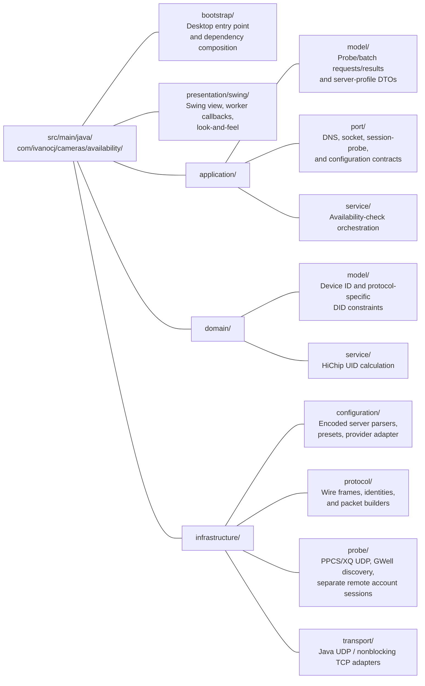
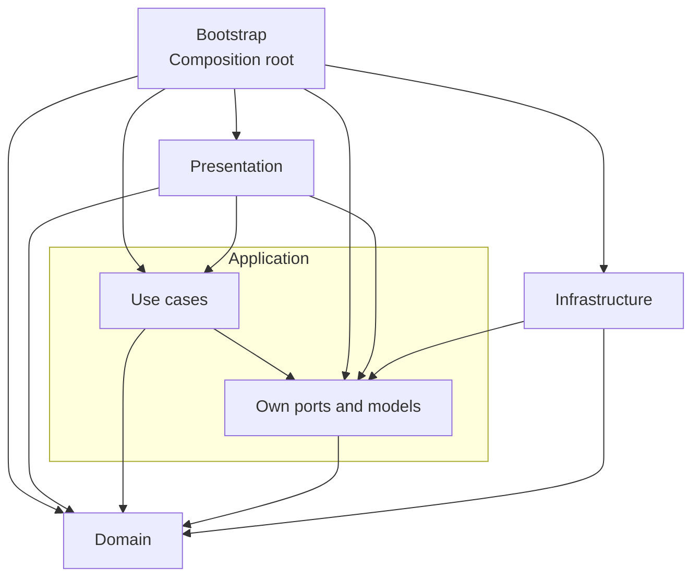

# Layered architecture

Base namespace: **`com.ivanocj.cameras.availability`**.

Maven coordinates: **`com.ivanocj.cameras:campulse:1.0.0`**.

## Production packages



### Domain

The sealed `DeviceIdentifier` family contains composite PPCS/XQ `DeviceId`, numeric `GwellDeviceId`, and opaque case-sensitive `IotVideoDeviceId`. GWell retains the leading-zero namespace bit rather than using PPCS's serial alias rule. `TransportProtocol` validates the corresponding identifier type and XQ length and supplies protocol-specific session keys. `HichipUid` remains a composite-DID helper. Domain types know neither UI nor packet encodings; wire generation belongs to infrastructure.

### Application

`AvailabilityCheckService` implements the `ProbeRunner` use case. It coordinates concurrent, bounded DNS resolution, the overall deadline, an owned socket, a session probe, and elapsed-time/result reporting. Its constructor receives `HostResolver`, `DatagramTransportFactory`, a clock, and `SessionProbeFactory`. It never instantiates an infrastructure implementation.

`ProtocolProbeRouter` dispatches PPCS/XQ to that legacy service, GWell to `GwellAvailabilityService`, and IoTVideo to `IotVideoRemoteProbe`. All backends implement `ProbeRunner`; routing never infers protocol compatibility from server names. The legacy service/codec reject Yoosee backends before DNS/socket work.

PPCS/XQ resolution keeps every distinct IPv4 address/port returned per host. Empty server lists and failed/timed-out DNS are allowed when LAN search is enabled; a broadcast route opens the independent LAN session with the remaining overall budget. Without LAN search, the original remote-server requirement remains. Empty server sets never produce a vacuous all-server rejection.

`GwellAvailabilityService` uses the `LanDiscovery` port, matches the full numeric namespace, and returns `DISCOVERED_LAN` with separate `GwellLanDevice` metadata—not an alive-confirmed peer. Cancellation retains partial metadata but remains cancelled; missing replies are inconclusive. Configured remote checks use the injected `GwellRemoteProbe`; a combined check reserves half the budget for LAN and gives the remaining time to remote presence. A failed listener does not block remote checking. LAN metadata is merged independently and never hides authentication/presence outcomes.

`BatchAvailabilityService` reads bare DIDs or `Serial,Description` CSV records from a caller-owned reader and matches complete normalized prefixes against explicit profile metadata. Apache Commons CSV handles quoted commas, escaped quotes, and multiline values; the use case validates the two required headers and retains descriptions and starting source-line numbers. Unknown/ambiguous deployments, invalid DIDs, and rows with the wrong column count are retained as skipped entries, never sent to reference servers. Both import and testing support cancellation, including buffered CSV reads.

The parallel checking overload bounds active probes to **1–16** (desktop default **8**) while retaining the full per-device timeout, LAN setting, profile, and transport. A coordinator uses a completion queue to refill freed slots immediately; it does not wait for a whole wave or an earlier slow row. Java 21 virtual threads run independent checks through the injected `ProbeRunner`; that runner and the cancellation supplier must support concurrent invocation. Each check owns its socket, session state, and network snapshot.

Entries are grouped by protocol-specific session identity: repeated normalized DIDs never overlap, and PPCS serials with different leading-zero padding share a group. XQ keeps the full ASCII DID. Explicit `GWELL:` batch entries retain the namespace bit, so `01234` differs from `1234`; explicit `IOTVIDEO:` entries preserve case. Bare numeric entries are skipped as ambiguous, not routed to PPCS defaults. Remote family profiles take precedence over empty-endpoint alternatives; unrelated/ambiguous deployments remain skipped. Rows within each group retain source order, descriptions, and independent results. Invalid/skipped entries consume no probe slot. Coordinator callbacks and source-ordered final results retain their existing behavior. Discovery and server-reported presence do not count as reachable. Remote account registration is additionally serialized by each shared backend adapter; these checks do not have the independent-session throughput of PPCS/XQ.

An atomic batch stop signal combines user cancellation with any probe's cancelled result. Cancellation marks queued entries untested, signals all active checks, and waits for their normal cleanup; workers are never forcibly cancelled or interrupted. A slot is released only after its runner returns, including socket close. Coordinator interruption and unexpected callback/probe failures also signal cancellation and wait for every active worker to finish cleanup; coordinator interrupt status is restored afterward. Expected per-row validation/I/O failures remain isolated from other devices.

`ProbeRequest`, `SessionRequest`, `ProbeResult`, `P2pInformation`, `BatchEntry`, `BatchResult`, `ServerConfiguration`, and `ServerProfile` are data contracts. Server configuration/profile collections are copied into immutable lists. `ProbeRequest` holds the user's unresolved hosts; `SessionRequest` holds the distinct resolved endpoints a session probe uses. `ServerConfiguration` reports the transport its encoding identifies, if any, and `ServerProfile` carries already-decoded endpoints, their transport, and normalized DID prefixes; neither interprets configuration syntax or display labels. Batch entries retain source-line numbers, descriptions, detected profiles, and validation explanations; batch results retain complete probe evidence when available. Descriptions are presentation metadata and never become part of a network probe request.

`ProbeResult.p2pInformation` is an immutable snapshot of protocol, selected connection mode, local endpoint, resolved/responding servers, device candidates, relay endpoints, and the last raw signed DID-lookup status per server. Ordered collections preserve reply order and are detached from the session state. `peer` is the DID-matched session endpoint (possibly a relay); `publicEndpoint` is the client's observed public mapping, not the device's. A selected mode or advertised candidate is not proof of alive confirmation: the result status remains authoritative. Original result constructors remain available with empty optional network metadata. `AvailabilityCheckService` preserves the snapshot when adding overall elapsed time, including DNS.

`ProbeRequest.identifier()` is the general identifier accessor; `did()` remains a checked legacy accessor and never coerces numeric/opaque keys. `ProbeResult.lanDevices()` and `LanDiscoveryResult` snapshot separate GWell metadata in immutable lists. `ProbeResult.remotePresence()` carries `RemotePresence` state, backend-matched source, optional reported timestamp, and receipt time. Yoosee adapters expose responding infrastructure without inventing a selected camera P2P mode, peer, public endpoint, or media port. Original constructors delegate with empty discovery/presence metadata. `YooseeCredentialSource` supplies per-check, closeable `YooseeAccount` snapshots with redacted diagnostics and backend-specific fields.

### Infrastructure

`ServerConfigurationParser` and `XqConfiguration` decode deployment configuration. `KnownServerProfiles` materializes the recovered presets and their source-confirmed prefix mappings, and `DefaultServerConfigurationProvider` implements the application's configuration port. The Bell reference preset has no automatic prefix mapping.

The PPCS/XQ LAN-only profiles have no endpoints or prefix mappings. GWell has separate LAN-only and remote profiles; IoTVideo has an account-required remote profile. `YooseeServerReferences` retains recovered production hostnames and supplies remote list endpoints on 51701, never legacy PPCS 32100. Backend-aware parsing preserves explicit ports and rejects encoded PPCS/XQ lists in a Yoosee form. Test/obsolete list-server constants are excluded.

`MessageType`, `PpcsPacket`, `PpcsMessages`, and `ProtocolMessages` own packet encoding. `UdpSessionProbe` implements `SessionProbe` for both SY and XQ: each check runs a `Session` object with one handler per message type. `UdpTransport` implements `DatagramTransport` using Java sockets.

`ProtocolMessages.matchesPeerIdentity` validates reply layouts before comparing the complete 20-byte wire identity. Only PPCS punch (`0x41`) and direct/LAN ready (`0x42`) replies may use the reference dissector's 24-byte layout, whose trailing API-version/reserved bytes are metadata rather than identity. Legacy replies, XQ, and relay-ready remain width-checked separately; unrelated message types and arbitrary trailing bytes are not accepted. `UdpSessionProbe` retains its existing endpoint checks, single-peer ownership, alive confirmation, and cleanup. Recognition changes neither outgoing messages nor application/UI contracts.

The session retains valid network replies on success, rejection, timeout, and cancellation, without additional probes. LAN candidates are tracked by discovery provenance, not by assuming every private IP is LAN. Relay discovery/allocation addresses are recorded separately from device candidates. A relay list is decoded completely before its addresses or server health are accepted; malformed/untrusted replies cannot become displayed evidence. Valid relay-routing replies count as server responses even when a device never completes the handshake.

`GwellDiscoveryMessages` is a separate big-endian command-1/2 codec. It validates actual datagram/header/extension lengths and extracts numeric identity, type/subtype, optional model, and MAC-word ordering. `GwellLanDiscovery` implements `LanDiscovery`, retries local broadcasts every second, polls at most 100 ms, ignores malformed/nonlocal replies, and caps snapshots at 256 identity/endpoint pairs. A cancellable/deadline-bounded lock serializes the shared adapter's fixed UDP-8899 listener; queued time consumes the caller's timeout. `Ipv4BroadcastTargets` supplies limited/directed interface broadcasts without DNS or subnet sweeps. `UdpTransport` supports an explicit listener port for discovery while PPCS/XQ keep ephemeral sockets. Every owned listener closes on success, cancellation, or failure.

`GwellRemoteProbe` and `IotVideoRemoteProbe` share only bounded I/O/ownership orchestration in `AbstractYooseeRemoteProbe`, not authentication/status commands. Credentials and known expiry are checked before DNS/sockets. Concurrent DNS retains all IPv4 endpoint/port pairs; `YooseeListDiscovery` validates configured sources/identities and safe TCP referrals. One per-adapter lock owns account registration through cleanup, including queued deadlines and cancellation.

`GuteTcpSession` correlates protocol byte, identity, command, sequence, and key mode, separates delivery ACKs from responses, limits retries/received frames, and handles bounded native fragmentation. `GuteFrameCodec` implements each backend's different checksum/identity rules using six-round `YooseeRc5`; the bootstrap constant is exactly 12 bytes. GWell uses initial verification trailers, certification/RSA key update, negotiated mode, and status counts. IoTVideo uses type-1 account certification/HMAC/AES, negotiated session identity, mapping records, model queries, and bounded level-2 `YooseeQuickLz`. `IotVideoModelPresence` uses constrained Jackson parsing and explicit timestamp freshness; SDK readiness, omissions, malformed values, and stale properties are not current camera-presence evidence.

`YooseeTcpTransport` owns nonblocking Java channels/selectors and fixed receive storage for split/coalesced TCP frames. `YooseeDeadline` shares a monotonic budget across DNS/discovery/connect/authentication/query, using bounded polling for cancellation. A validated presence result is published only after socket, key schedule, and fragment cleanup. `FileYooseeCredentials` rereads bounded regular UTF-8 properties files, rejects symlinks, never includes credential contents/paths in errors, and keeps only the current selection in memory. Mutable account/key arrays are erased on a best-effort basis; no JVM secure-memory claim is made.

[YOOSEE_NATIVE_ANALYSIS.md](YOOSEE_NATIVE_ANALYSIS.md) records hashes, named functions/offsets, source correspondence, protocol flows, and remaining authorized live validation. The Ghidra helper and Python fixture generator under `research/` are not Maven/application dependencies. **Live cloud/camera interoperability remains unverified.**

### Presentation and bootstrap

`presentation.AvailabilityPresenter` turns form input into a `ProbeRequest`, individual results into display text/tones, and batch outcomes into progress and summary wording; it has no Swing dependency. `AvailabilityPanel` depends on the presenter, domain types, application DTOs, `ProbeRunner`, `ServerConfigurationProvider`, `BatchAvailabilityService`, and a `FormMemory`. It handles layout, file selection, input/display, and EDT/worker coordination without importing parsers, codecs, or socket adapters. File I/O and probes run off the EDT; the read-only `BatchResultsTableModel` and all view updates are EDT-owned. The **Parallel batch checks** spinner is batch-only, has an associated label/tooltip, and stays disabled with other inputs until all active checks finish cleanup. Batch diagnostics and summaries report the selected limit. A completed batch row can be selected to inspect the original result metadata without altering the single-check form. `AvailabilityTheme` is the single source of colours and fonts.

The reachability card shows device IP/port separately from the session endpoint and client public endpoint, plus selectable read-only P2P information. Batch rows expose device/session/client addresses and connection mode incrementally; sorted selection displays the original snapshot with the row's DID/description. Formatting never performs DNS. Missing device addresses are explicit (`Not returned`) and never replaced with a relay/client address. Non-probe display states clear the network evidence, preventing stale addresses from being attributed to another device.

`bootstrap.AvailabilityApplication` is the composition root. It wires the protocol router, JDK resolver/clock, legacy UDP session, shared GWell fixed-port discovery adapter, independent remote adapters, private-file credential source, configuration provider, and preferences. An optional `YOOSEE_CREDENTIALS_FILE` initializes the ephemeral credential selection. The panel receives only a selection callback, not the infrastructure loader; account contents/path never enter `FormMemory`. Credential controls stay locked through cleanup. Choosing a Yoosee backend builds that backend's identifier rather than applying composite DID rules. Presence/authentication/discovery wording is rendered on the EDT without claiming camera reachability or increasing reachable batch counts.

### Operational logging

Application, infrastructure, bootstrap, and Swing components emit parameterized events through **SLF4J**, not through the UI progress callback. Domain validation remains logging-free. `application.logging.LogContext` provides scoped opaque batch/probe UUIDs and source-line context; callers' MDC is restored on success or failure. Batch workers and DNS virtual threads explicitly inherit a copied context, so correlation does not depend on thread-local inheritance or leak into another operation. A probe's terminal INFO event is emitted after the runner returns, including socket cleanup; expected timeout/rejection/cancellation outcomes are not application errors.

`infrastructure.logging.ApplicationLogging` owns the **Logback** backend. The executable calls it before opening Swing; it configures UTC/UTF-8 events, the application level, a WARN/ERROR console, a bounded asynchronous rolling file appender, and the shutdown/uncaught-exception lifecycle. The default active file is in the user's private `.ppcs-availability/logs` directory, rotates at 10 MiB, and retains five gzip archives. A lock prevents concurrent processes from rotating the same files; unavailable/shared/symlinked directories degrade to console logging without altering unrelated files or existing permissions. `ppcs.log.dir` and `ppcs.log.level` are read once at startup.

`OperationalAsyncAppender` discards only verbose DEBUG/TRACE records under pressure; operational INFO/WARN/ERROR records use bounded-queue backpressure. Shutdown switches enqueueing to non-blocking and has a five-second file-flush budget. `SafeLoggingStatusListener` reports backend errors directly to the console with rate limiting, avoiding recursive writes to a failed file appender. `SafeThrowableConverter` retains bounded exception types/frames/causes/suppressed information but never formats raw exception messages. Application events do not include DIDs, descriptions, addresses, server strings, imported filenames/paths, raw packets, or the UI's progress/result text. DNS thread names use server ordinals, not hostnames.

The on-screen trace remains an independent, EDT-owned diagnostic view and deliberately retains detailed device information. Its Clear action never clears persistent logs. Production code outside infrastructure/bootstrap cannot depend on Logback; the ArchUnit contract enforces that boundary. `logback.xml` is a safe console bootstrap, while `logback-test.xml` disables automatic test logging; tests install explicit isolated/capture appenders. Maven Shade merges service-provider descriptors so the executable contains exactly one working SLF4J provider.

The bootstrap attaches the panel's File menu to the frame. **Open batch file…** and the batch button share a single Swing action, including the platform Open shortcut and enabled state during worker cleanup. `.csv` files use the CSV reader; other selected files retain the original one-DID-per-line text flow. `src/test/resources/batch-synthetic.csv` is fabricated, test-only input and is never packaged or automatically probed. Maven explicitly allows only `logback.xml` as a runtime resource, preventing local inventories or account files from entering the application JAR.

## Dependency directions

Arrows point from the dependent to the layer or contract it uses. Bootstrap connects all layers for composition.



Domain/application do not depend on Swing or FlatLaf. Application/presentation do not depend on infrastructure implementations. Infrastructure does not depend on presentation or bootstrap.

## Tests

Unit packages mirror their production layers. Protocol byte-vector tests are in `infrastructure.protocol`; protocol-length validation is in `domain.model`. `integration.transport` wires real application/infrastructure components for the SY and XQ UDP round trips.

`integration.SyntheticBatchImportTest` imports the 17-row fabricated CSV using the real catalog and an assertion-only probe runner: all descriptions are retained, 15 codes have known PPCS/XQ/GWell/IoTVideo profiles, and two unsupported-prefix rows are preserved without network work. `integration.PublicResourcesTest` enforces the runtime resource allowlist.

P2P-information regressions cover immutable snapshots, incomplete/cancelled replies, trust/validation, direct/LAN/relay provenance, raw per-server status retention, runner elapsed-time wrapping, and incremental/sorted single/batch display. The real-socket integration tests verify that PPCS/XQ network information survives the complete runner/probe stack.

Parallel application tests use controlled latches to verify bounded overlap, immediate slot refill, duplicate/alias serialization, source order, serialized callbacks, isolated failures, cancellation, interruption, and cleanup after unexpected errors without timing-sensitive throughput assertions. Swing tests verify the default/bounds, incremental out-of-order results on the EDT, retained P2P identity after sorting, and input/menu locking through every active probe's cleanup on cancellation or window close. `ParallelBatchLoopbackTest` uses local UDP fixtures that require both PPCS and XQ rendezvous requests before replying, then verifies independent sockets, protocol identities, snapshots, alive confirmation, and close.

Logging regressions exercise isolated backend contexts and capture use-case events without writing to real user storage. `integration.logging.LoggingProcessTest` launches separate JVMs against fake DNS/datagrams, verifies default/custom directories and startup/shutdown hooks, and checks that all 100 parallel outcomes and DEBUG session summaries survive asynchronous flushing without device data. File rotation and privacy/fallback tests use temporary directories only; no camera service is contacted.

`testsupport` contains shared device/configuration fixtures and independent doubles. Application-service tests inject a session-probe double instead of reusing another layer's test class. Presentation tests inject a configuration double instead of importing an infrastructure test helper.

`architecture.LayeredArchitectureTest` imports production bytecode and enforces the namespace, layer dependencies, key class placements, and the absence of Swing/FlatLaf dependencies in domain/application. It was introduced red against the original flat package and passed after the refactor.

Run all contracts and behavior tests with:

```sh
mvn clean verify
```

The executable manifest points to `com.ivanocj.cameras.availability.bootstrap.AvailabilityApplication`; the JAR is `campulse-1.0.0.jar` and requires Java 21.

Yoosee/DNS additions include real loopback tests for independent PPCS/XQ alive/close sessions, GWell metadata-only discovery/port release, and both remote account-registration/query/cleanup flows. Independent RC5/list/init/token-certification vectors, bounded TCP/fragment/QuickLZ/JSON tests, account expiry/ownership/cancellation, credential-file reload/selection/privacy, all IPv4 ports, and presence/LAN/authentication presentation protect the evidence boundaries. The public CamPulse snapshot's clean verification passes **580 tests** with no failures/errors/skips, including desktop workflow regressions and the runtime-resource allowlist. No fixture contacts recovered cloud endpoints or physical cameras.
