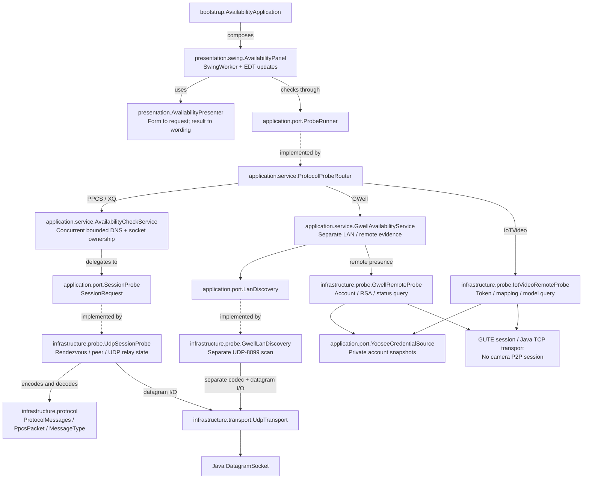

# CamPulse

**Camera connectivity, discovery, and presence diagnostics — beyond a single protocol.**

A **Java 21 Swing desktop application** with pure Java **SY/PPCS and XQ IPv4 UDP availability checks**, independent LAN checking, **GWell/Yoosee LAN discovery**, and separate account-backed **GWell and IoTVideo remote-presence checks**. FlatLaf provides the dark desktop theme. Remote adapters are experimental: native-derived flows and loopback tests are implemented, but **live cloud/camera interoperability remains unverified**. See [YOOSEE_NATIVE_ANALYSIS.md](YOOSEE_NATIVE_ANALYSIS.md).

The application code, transport, packet codecs, server-configuration decoder, and HiChip UID helper are Java. **No PPCS native library, JNI/JNA binding, C compiler, or Python runtime is needed.** FlatLaf's optional native integration is disabled and its native binaries are excluded from the executable JAR.

Use CamPulse only with devices and accounts you own or are authorized to test. This public repository starts with a fresh history and contains **no private device inventory or account files**. Its batch fixture is fabricated and test-only; it is not bundled in the application or intended for live probing. See [PRIVACY.md](PRIVACY.md) for publication safeguards.

## Build and run

Requirements: JDK 21, Maven 3.9+, and a graphical desktop to run Swing. Tests run headlessly and use local sockets; they do not contact camera services.

From this directory:

```sh
mvn clean verify
java -jar target/campulse-1.0.0.jar
```

To build a native application bundle with `jpackage` (an app image by default; pass `-Djpackage.type=dmg`, `pkg`, `msi`, `exe`, `deb`, or `rpm` for an installer on the matching platform):

```sh
mvn -Pinstaller package
```

The bundle is written to `target/installer/`.

Open `pom.xml` in IntelliJ IDEA, Eclipse, or another Maven-aware Java IDE. Maven coordinates are `com.ivanocj.cameras:campulse:1.0.0`. The entry point is `com.ivanocj.cameras.availability.bootstrap.AvailabilityApplication`. Existing Java package names, Preferences storage, `ppcs.log.*` properties, and the log-directory default are retained for compatibility.

## Check a device

1. Enter your authorized device's DID. A fabricated format example is `FFFF-000009-DEMO`; do not probe example identifiers.
2. Select the matching deployment in **Known lists**, or edit the server field directly. Accepted inputs are SY or supported XQ encoded server strings, or comma-separated IPv4 hosts optionally with a UDP port:

   ```text
   p2p.vendor.example:32100, 192.0.2.10:32100
   ```

3. Choose **Transport: PPCS** for SY/PPCS or **XQ** for XQ. A known profile selects its transport automatically. An encoded configuration decides its own transport when the check starts: a pasted `-$$` string selects XQ and an SY-encoded string selects PPCS. Choosing a profile after editing the server list asks before replacing your edits. Choose an overall timeout, including server resolution, and whether to search the local network.
4. Click **Check availability** or press Enter. **Cancel** signals cancellation and lets the worker close its socket/session normally.
5. Read the reachability result, **Device IP / port**, session endpoint, client public endpoint, elapsed time, and **P2P information** in the reachability card. The P2P text can be selected and copied. Each run in the diagnostic trace starts with a timestamped header; the trace keeps the most recent 2,000 lines and can be cleared.

The last submitted protocol-specific identifier, profile, servers, transport, timeout, and LAN setting are remembered between launches through the Java Preferences API.

The prefilled servers come from `bell-jpg/p2p/p2p.c`'s older default configuration:

```text
one.object-camera.com,174.129.34.188,four.object-camera.com
```

They are a reference configuration, not a universal PPCS service. Use the configuration matching the actual device. Example identifiers are not claims that a camera exists or is reachable.

**Known lists** also offers six configurations recovered from `HIP2PClient_2.1.2.app`: SY `WWWW`/`TTTT`/`UUUU`, older SY `AAAA`–`EEEE`, `AAES`, Dericam `DEAA`, `FDTAA`, and `SECRUI`. These add 18 endpoints; seven returned PPCS hello acknowledgements during a dated live check, including all three in the newer SY group. The recovered configurations and current-response evidence are documented in [HIP2P_SERVER_ANALYSIS.md](HIP2P_SERVER_ANALYSIS.md).

The native client routes `FFFF`/`GGGG`/`HHHH` through its separate XQ SDK. The Java checker now supports that XQ availability transport and offers presets for `FFFF`/`HHHH`/`GGGG`, `IIII`/`JJJJ`/`KKKK`, and `XXXX`/`YYYY`/`ZZZZ`. Eight of their ten endpoints returned server hello acknowledgements in a dated check. See [XQ_TRANSPORT.md](XQ_TRANSPORT.md) for wire evidence, verification, and supported scope.

The optional **Build HiChip DID** helper reproduces `uid.py`: the `HHPPD` input, MD5 rounds with a **zero-initialized state**, and the first five hexadecimal letters. It does not use standard Java MD5, whose initialization values would produce a different result. A supplied DID is validated for the wire format without imposing the HiChip checksum on other vendors' IDs.

### LAN-only checks and Yoosee families

- **PPCS/XQ LAN-only:** choose **PPCS · LAN only** or **XQ · LAN only**, enter the composite DID, and enable **Search local network**. Servers may be blank. The original DID/ready/alive exchange still determines reachability. If configured servers fail DNS or exceed its bounded budget, the remaining time is used for LAN checking rather than aborting. DNS retains **every distinct IPv4 address/port**, not just the first answer.
- **GWell/Yoosee LAN:** choose **Yoosee · GWell LAN discovery**, enter the numeric ID exactly as displayed (for example `01234`), and enable LAN search. The checker broadcasts on UDP **8899**, listens on that fixed port, and displays **Discovered on LAN** plus available type/subtype/model/MAC metadata. The discovery endpoint is not a confirmed P2P/media endpoint. `01234` and `1234` are different identity namespaces.
- **GWell remote:** select **Yoosee · GWell remote presence (account required)** and a private account file as described below. LAN search optionally retains discovery metadata independently of the remote result.
- **IoTVideo remote:** select **Yoosee · IoTVideo remote presence (account required)** and retain the original case-sensitive device key. The adapter supports complete unsigned decimal device IDs and opaque keys mapped by the account-registration response; an unmapped key remains unknown, never guessed or converted to PPCS.

GWell scans share one fixed listener and are serialized; waiting counts against each check's timeout. Close other programs using UDP 8899 if listener setup fails. Default discovery accepts private/loopback/link-local IPv4 replies, which remain unauthenticated metadata. No LAN response means **unknown availability**, not offline. Remote profiles use backend-specific list servers on UDP **51701**, then connect to returned TCP infrastructure. Those endpoints are not camera addresses or PPCS UDP-32100 services. Blank servers provide LAN-only checking for PPCS/XQ/GWell, not IoTVideo.

### Private Yoosee account credentials

Use **Select Yoosee account file…**, or set **`YOOSEE_CREDENTIALS_FILE`** before launching the app. The file is a UTF-8 `.properties` file, read afresh per remote check. Selection and contents are **not saved in preferences or logs**; **Clear account file** removes the active selection, including one supplied by the environment. Credential controls stay locked through worker cleanup. No credentials means `AUTH_REQUIRED` before DNS or sockets.

Create the file outside the repository and restrict it to your user (normally **0600** on POSIX). Only bounded regular files up to **16 KiB** are accepted; symlinks are refused. Replace the placeholders below with values obtained through your own authorized account login, and include only the backend sections you use:

```properties
# GWell account-login fields, NOT the target camera's ID or password.
gwell.userId=YOUR_ACCOUNT_USER_ID
gwell.sessionId1=YOUR_SESSION_ID_1
gwell.sessionId2=YOUR_SESSION_ID_2
gwell.code1=YOUR_P2P_VERIFY_CODE_1
gwell.code2=YOUR_P2P_VERIFY_CODE_2
# Optional, only when its actual expiry is known:
# gwell.expiresAt=2026-10-08T10:00:00Z

# IoTVideo SDK access credentials, NOT cloud SecretId/SecretKey.
iotvideo.accessId=YOUR_UNSIGNED_DECIMAL_ACCESS_ID
iotvideo.accessToken=YOUR_128_HEX_CHARACTER_TYPE_1_ACCOUNT_TOKEN
# iotvideo.expiresAt=2026-10-08T10:00:00Z
```

GWell login words accept signed 32-bit or unsigned 32-bit decimal representations. Preserve the account user ID's leading-zero namespace. IoTVideo accepts exactly **64 decoded bytes**, token type **1** (first byte `01`); anonymous/device-token variants are not silently substituted. Known expiry or registration rejection yields `AUTH_FAILED`, not device-offline evidence. A later login can supersede the supplied session; refresh it through the authorized login provider. This app does not log in, mint tokens, extract APK credentials, or save a password. Mutable account/key buffers are erased on cleanup on a best-effort JVM basis; this is not secure-memory storage.

Only a correlated status/model reply can report presence. IoTVideo requires `_online` equal to numeric `0` or `1` with an epoch-second timestamp; values older than **two minutes** are `STALE`, and missing/invalid values are `UNKNOWN`. GWell's status reply supplies no timestamp, so receipt time and provenance are shown separately. Neither means an alive-confirmed camera P2P session.

## Batch check a CSV or text file

The [synthetic batch fixture](src/test/resources/batch-synthetic.csv) demonstrates the expected **`Serial,Description`** CSV format with 17 fabricated records. It lives in **test resources only**, is never bundled in the application, and is imported without network work in tests. Private CSVs and account files are excluded from Git; keep your real inputs outside the repository.

1. Prepare a **UTF-8 `.csv` file with `Serial` and `Description` columns**, for example:

   ```csv
   Serial,Description
    FFFF-000009-DEMO,Synthetic XQ camera
    WWWW-000004-DEMO,Synthetic PPCS camera
    DEAA-000006-DEMO,Synthetic Dericam camera
    GWELL:01234,Synthetic GWell identifier
    IOTVIDEO:demo-device-key,Synthetic IoTVideo key
   ```

2. Choose the timeout, LAN-search setting, and **Parallel batch checks** (default **8**, range **1–16**), then use **File → Open batch file…** (⌘O on macOS, Ctrl+O elsewhere), or the **Open batch file & test…** button. Select your authorized device list, not the synthetic fixture: **testing starts automatically**. The timeout applies **to each code**, not to the whole batch; increasing parallelism does not shorten it. Choose **1** for sequential testing.
3. Watch **Batch results** for each record's source-line number, serial/DID, **description**, detected server profile, transport, availability result, **Device IP / port**, **Session endpoint**, **Connection mode**, **Client public endpoint**, explanation, and elapsed time. Descriptions remain visible for successful, failed, skipped, and cancelled rows. Results arrive incrementally; the table can be sorted and scrolled horizontally. After the batch finishes, select a row to inspect its full **P2P information**, including the DID and description, in the reachability card. Hover over a cell to read its full text.
4. **Cancel**, or close the window, to stop. All active probes complete their normal cleanup; unstarted codes are marked cancelled with a “Not tested” explanation. Completed results remain available.

Each composite DID's **complete prefix** selects its known PPCS/XQ deployment. Yoosee entries require an explicit **`GWELL:`** or **`IOTVIDEO:`** family tag; untagged numbers are skipped rather than guessed. Routing is independent of the manual server/transport fields. The single-device form and its saved settings are not replaced by a batch run.

| DID prefixes | Deployment / transport |
| --- | --- |
| `WWWW`, `TTTT`, `UUUU` | HIP2P SY / PPCS |
| `AAAA`, `BBBB`, `CCCC`, `DDDD`, `EEEE` | Older HIP2P SY / PPCS |
| `AAES` | AAES / PPCS |
| `DEAA` | Dericam / PPCS |
| `FDTAA` | FDTAA / PPCS |
| `SECRUI` | SECRUI / PPCS |
| `FFFF`, `HHHH`, `GGGG` | HIP2P XQ |
| `IIII`, `JJJJ`, `KKKK` | HIP2P XQ |
| `XXXX`, `YYYY`, `ZZZZ` | HIP2P XQ |
| `GWELL:01234` | GWell remote presence with the selected account; optional LAN discovery |
| `IOTVIDEO:device-key` | IoTVideo remote presence with the selected account and device mapping |

CSV headers are case-insensitive and may be reordered; both named columns are required. Descriptions may be empty or contain Unicode text, quoted commas, escaped quotes (`""`), and quoted line breaks. Serial numbers are kept as DID strings, preserving leading zeros. Blank CSV records and a UTF-8 BOM are supported. Records spanning multiple lines retain their starting source-line number.

**Plain `.txt` files remain supported:** one full DID per line, with optional whitespace, blank lines, and whole-line `#` comments. These rows have an empty description. Repeated codes retain separate descriptions/results and source-line numbers. Each check owns a fresh socket/session. Distinct DIDs run concurrently up to the selected limit, and a free slot starts another device immediately rather than waiting for earlier rows. Repeated DIDs run one at a time so one session's cleanup cannot interfere with another; PPCS serials differing only in leading zeros also share a slot, without changing their displayed serial strings. XQ uses the full ASCII identity. A DNS/socket/I/O failure is recorded for that code without stopping the others. Both the menu item and button stay disabled until every active probe completes cleanup.

Text files also accept family-tagged Yoosee entries. GWell groups use the complete numeric wire identity, including bit 31: `GWELL:001234` and `GWELL:01234` serialize together, but `GWELL:1234` is a different identity. IoTVideo keys preserve case. Discovery and remote-presence outcomes never increase the batch's **reachable** count. Each shared remote adapter serializes its backend's account registrations through socket/key cleanup, even for different camera IDs; queue time consumes the caller's timeout. Use sequential batches or sufficient timeouts for account-backed checks. The throughput estimates below apply to independent PPCS/XQ sessions, not serialized GWell scans or Yoosee registrations.

Malformed DIDs, CSV rows with the wrong column count, protocol-length violations, and unknown or ambiguous prefixes are **skipped without network testing**, with the reason shown in the table. The synthetic fixture's `NNNN` and `WXH` records have no known profile and are skipped; their descriptions are retained. The Bell reference configuration is never used as an automatic fallback. For an unknown deployment, use the single-device check with the actual server list and transport. An empty/unreadable file, invalid CSV header, or malformed CSV quoting is reported before any probes start. Merely launching the app does not import or test any batch file.

### Batch throughput

The main batch bottleneck was waiting for one device's entire timeout before starting the next. Bounded parallel checks overlap that waiting without reducing retry or confirmation time. For **100 distinct DIDs that each use a 10-second timeout**, the approximate waiting time becomes:

| Parallel checks | Approximate waiting time |
| --- | --- |
| 1 | 16 min 40 s |
| 8 (default) | 2 min 10 s |
| 16 | 1 min 10 s |

These are scheduling estimates, not live-camera measurements; DNS, socket setup/cleanup, duplicate DIDs, and server throttling can affect the total. Reachable or rejected devices can finish sooner. Start with **8**, increase to **16** if the deployment handles it, or reduce the limit if replies become less reliable.

An offline benchmark using **100 fake probes with a 100 ms simulated wait each** measured **10.63 s sequentially**, **1.40 s at 8-way parallelism (7.6× faster)**, and **0.75 s at 16-way parallelism** on the development host. Every row completed independently and the active-probe count stayed within its limit. No external camera services were contacted.

## Returned P2P information

Single-device results and selected batch rows expose the network information collected by the PPCS/XQ exchange:

- Protocol and selected connection mode: **Direct P2P**, **LAN**, or **UDP relay**, with separate alive-confirmation evidence. A selected but incomplete session is marked **not confirmed**.
- Returned/discovered **device IP addresses and UDP ports**, including candidates received before a timeout or cancellation. Multiple candidates are retained; an advertised IP alone does not confirm reachability.
- The DID-matched **session endpoint**, **client local endpoint**, and **client public endpoint** reported by the server. The client public endpoint is this computer's NAT mapping, **not the camera's IP**.
- Resolved and responding server endpoints, returned/allocated relay endpoints, and each server's last DID-lookup acknowledgement byte in signed, unsigned, and hexadecimal forms. These are raw wire statuses, not native SDK error codes.

A device can be reachable **through a relay without returning its own IP**. In that case the Device IP field explicitly says **Not returned**, while the session/relay endpoint is still shown. The app never substitutes a relay or client IP for a missing device IP, guesses an address, or performs an extra lookup to obtain one. Information not present in the exchange, such as a native SDK NAT-type classification, is not invented.

Addresses are retained independently for each batch row, even for repeated DIDs. Starting another check, displaying an input/error state, or selecting an untested/skipped row clears the previous P2P information. Collecting and displaying these details does not add camera commands or authentication.

## What a result means

| Result | Evidence |
| --- | --- |
| `REACHABLE_P2P` | A DID-matched direct/LAN ready packet and an alive acknowledgement from the selected peer. |
| `REACHABLE_RELAY` | The legacy UDP relay handshake, a DID-matched relay-ready packet, and an alive acknowledgement. |
| `SERVER_REJECTED` | All configured servers returned nonzero DID-request acknowledgement statuses and no peer was confirmed. Raw signed/unsigned wire statuses are recorded. |
| `TIMED_OUT` | A bounded exchange deadline expired without confirmed reachability/presence. Missing replies do not prove offline. |
| `INCONCLUSIVE` | No validated reachability/presence result, including unknown or stale model data. |
| `CANCELLED` | The user or closing window requested cancellation. |
| `DISCOVERED_LAN` | A matching, unauthenticated GWell LAN discovery reply. No P2P session or alive exchange was tested. |
| `REPORTED_ONLINE` / `REPORTED_OFFLINE` | Correlated server-reported presence; camera P2P reachability was not tested. |
| `AUTH_REQUIRED` | User-authorized backend account credentials are missing; no remote packets were sent. |
| `AUTH_FAILED` | Known account expiry or registration rejection; not evidence that the camera is offline. |
| **Check failed** | A local setup, DNS, socket, or I/O failure; the actual error is displayed. |

A server hello, delivery ACK, or SDK-ready callback is **not** evidence that the device is reachable. A timeout or rejection is **not** proof of power-off. PPCS/XQ checks test transport reachability; Yoosee checks authenticate the client account to infrastructure and query presence, not a camera/media session.

Server acknowledgement bytes are wire statuses, **not** the SDK's `PPCS_Connect` return-code enumeration. The application retains those bytes rather than incorrectly translating them into the negative codes in `PPCS_Error.h`.

## Production logging

The executable initializes **SLF4J 2 / Logback** before opening the desktop. Persistent UTF-8 logs are separate from the on-screen diagnostic trace, so clearing the trace does not remove log files.

- Default file: **`~/.ppcs-availability/logs/availability.log`** on every platform (`~` means the Java user's home directory).
- Rotation: **10 MiB** per file with **five gzip backups**, `availability.1.log.gz` through `availability.5.log.gz`; `.1` is the newest archive. Retention is size/count-based, not age-based. The active file plus backups represent approximately 60 MiB of uncompressed records, with a possible final-record overshoot.
- Default application level: **INFO**. Startup/shutdown, each probe's outcome/timing, batch import/summaries, and cancellation are recorded. **WARN/ERROR** cover DNS/send failures, invalid input, local setup/I/O problems, settings persistence, and uncaught exceptions. **DEBUG** adds bounded protocol-stage diagnostics, raw numeric server statuses, and per-row events—not packet dumps or one log line per ignored packet. Third-party logging stays at WARN.
- Every record includes a **UTC timestamp**, level, thread, logger, and an opaque launch ID. Scoped **batch/probe IDs** and batch **source-line numbers** correlate parallel probes and their DNS tasks without persisting device identities.

Enable detailed diagnostics or select a different dedicated log directory with JVM properties **before `-jar`**:

```sh
java -Dppcs.log.level=DEBUG \
     -Dppcs.log.dir="$HOME/.ppcs-availability/support-logs" \
     -jar target/campulse-1.0.0.jar
```

Supported levels are `TRACE`, `DEBUG`, `INFO`, `WARN`, `ERROR`, and `OFF`; invalid values fall back to INFO with a warning. Existing custom directories are not chmodded: use a private directory (owner-only permissions, normally **0700**, on POSIX). New directories/active files use owner-only POSIX permissions where supported; other platforms use their inherited filesystem permissions. Symlinked log directories/files/archives are refused. An exclusive directory lock prevents two application instances from corrupting the same rotating files; give additional instances different directories if they also need disk logs.

File writing uses a **bounded 4,096-event asynchronous queue**. Only DEBUG/TRACE records may be discarded when the queue is nearly full; INFO/WARN/ERROR apply backpressure rather than being silently dropped during normal operation. Console output normally contains WARN/ERROR only. If disk logging cannot initialize, the application continues with console logging at the selected level. Runtime backend failures are reported through a safe, non-recursive, rate-limited console path. Shutdown switches enqueueing to non-blocking and gives queued file records up to **five seconds** to flush; a full shutdown queue, disk failure, forced termination, or an exhausted flush deadline can still lose records.

**Privacy:** application events omit DIDs, descriptions, device/client/server addresses, server configurations, imported filenames/paths, and raw packet data—even at DEBUG. Exception types, bounded stack frames, causes, and suppressed exception types are retained, but **raw exception messages are omitted**, since DNS/file/network errors can contain sensitive values. The local Swing trace and P2P results intentionally still show the user's detailed device information; do not confuse that trace with the privacy-conscious support log files.

## Implemented protocol profiles

This is an availability-focused port of the **legacy plaintext IPv4 UDP PPCS/PPPP profile represented by the supplied Linux samples**:

- `F1` framing, big-endian payload lengths, fixed-width DID fields.
- Legacy 54-byte-key server-string decoding, port 32100 by default.
- Server hello and DID-specific rendezvous requests.
- LAN discovery on UDP 32108 and direct peer punching/readiness.
- Legacy UDP relay discovery, port allocation, relay requests, and relay readiness.
- Alive confirmation, retransmission, cancellation, monotonic deadlines, and session-close datagrams.

PPCS punch (`0x41`) and direct/LAN ready (`0x42`) replies accept both the legacy **20-byte identity** and the **24-byte extended layout** described in `../dissector/pppp.fdesc`: the same binary identity followed by three API-version bytes and one reserved byte. All 20 identity bytes must match the requested DID; the four metadata bytes do not participate in matching and are not displayed. Other payload lengths are ignored. Endpoint validation, single-peer ownership, alive confirmation, retries, and cleanup are unchanged. Outgoing messages retain their legacy format; XQ and relay-ready (`0x84`) replies still require exactly 20 bytes. This is reply-format recognition, not full Yi/TNP protocol support, and adds no dependency on the reference dissector.

The XQ IPv4 UDP path uses the same availability sequence with its full 20-byte ASCII DID identity, uppercase-pair `-$$` configuration decoder, opaque relay cookies, and heartbeat acknowledgement. Protocol selection is retained across server resolution and socket setup. XQ DIDs longer than 20 bytes are rejected before network work.

GWell UDP-8899 discovery uses its own big-endian command `1`/`2` codec, 1024-byte zero-padded search request, numeric identity, and flag-controlled metadata. The decoder checks actual datagram lengths instead of manufacturing the decoded app's 200-byte buffer limit. Retries, bounded receive polling, cancellation, immutable/capped discovery snapshots, directed broadcasts, and fixed-listener cleanup are implemented independently of PPCS/XQ.

The remote adapters separately implement little-endian GUTE framing, six-round RC5, GWell RSA certification/key update and `0x2D` status queries, and IoTVideo token certification, negotiated identity/mappings, `0xB7` model queries, and bounded QuickLZ level-2 decoding. TCP reads handle split/coalesced frames and native `0x70` fragments. Request/response identity, command, sequence, and key mode are correlated under bounded retries/deadlines and cancellation. These recovered legacy cryptographic modes are **not a modern security design or TLS**. HTTP list fallback, alternate token/registration schemes, and camera/media connections are not implemented. Authorized live interoperability still needs validation.

The newer keyed/encrypted SY packet profile, DSK/CRC/smart-device extensions, IPv6, TCP relay negotiation, and constrained XQ configuration suffixes other than `-$$` are **not implemented**. Unsupported configuration forms are rejected. This is not a complete replacement for every version of the proprietary SDKs.

## Architecture

Single-device runtime flow. Dashed links identify implementations wired by the bootstrap, not compile-time dependencies from ports to infrastructure.



`ProbeRequest.identifier()` carries a sealed protocol-specific `DeviceIdentifier` plus settings and `TransportProtocol`. Its legacy `did()` accessor remains available only for composite PPCS/XQ identifiers. `ProbeResult` carries immutable `P2pInformation`, separate LAN metadata, and optional `RemotePresence` with provenance/times. The router never passes GWell/IoTVideo into the legacy codec. The PPCS/XQ runner resolves hosts concurrently within half the timeout, retaining all distinct IPv4 address/port combinations; failed, slow, or IPv6-only hosts are skipped with diagnostics. `SessionRequest` may have no servers only when LAN search is enabled. The remaining overall budget, protocol, and network evidence are preserved through socket setup and elapsed-time reporting. Each check owns its socket; a selected DID-matched session has one owner and is closed on terminal outcomes. GWell owns a separate serialized UDP-8899 listener; remote adapters own independent, serialized account registrations. The Swing view receives only application contracts and keeps inputs locked through cleanup.

`application.service.BatchAvailabilityService` imports text lines or CSV records (using Apache Commons CSV), resolves explicit `ServerProfile.prefixes` metadata, validates each protocol, and invokes the same probe runner with bounded parallelism on Java 21 virtual threads. Scheduling serializes repeated identities and includes cleanup in each occupied slot. Completion/diagnostic callbacks remain serialized on the coordinator, incremental updates arrive in completion order, and the returned immutable results retain source order. The original service overload remains sequential for compatibility. `BatchEntry` and `BatchResult` preserve descriptions, source-line validation, and complete probe evidence. File reading and checking run in a Swing worker; `BatchResultsTableModel`, progress, diagnostics, and summaries are updated only on the EDT. The File menu and batch button share one Swing action and its busy state.

Production and unit-test packages follow the same layer structure under `com.ivanocj.cameras.availability`. Cross-layer socket fixtures live in `integration.transport`, reusable test doubles in `testsupport`, and dependency contracts in `architecture`. See [ARCHITECTURE.md](ARCHITECTURE.md) for responsibilities and allowed dependency directions.

## Source correspondence

| Input | How it informed the Java implementation |
| --- | --- |
| `../PPCS_ARCHITECTURE.md` | Reachability semantics, separate server health, session ownership, and worker-thread UI integration. |
| `../uid.py` | Zero-state MD5 and HiChip UID generation. |
| `../Drivers/include/PPCS/PPCS_API.h` | DID buffer size, client connection/session concepts, direct versus relay mode. |
| `../Drivers/include/PPCS/PPCS_Error.h` | Distinguishing SDK return codes from packet acknowledgement bytes. |
| `../bell-jpg/p2p/p2p.c` | Deployment-specific initialization strings and the reference server configuration. |
| `../P2P-solution/Other_Platform/Linux/` | Legacy library/sample profile. The decoder's 54-byte constants were recovered by inspecting the supplied library's `PPPP_DecodeString` implementation. The library is not packaged or loaded. |
| `../libPPCS_API/cs2p2p_PPPP_Proto_*.c` | Message types, DID layouts, peer punching, relay exchange, alive/close framing. |
| `../libPPCS_API/cs2p2p_{htonAddr,ntohAddr}.c` | Legacy sockaddr serialization, including the reversed IPv4 bytes and little-endian port on the wire. |
| `../dissector/pppp.fdesc` | Reference-only descriptions of the 24-byte binary-UID punch/ready reply layouts. No dissector code or plugin is packaged or loaded. |
| `../HIP2PClient_2.1.2.app/Contents/MacOS/HIP2PClient` | SY/XQ configurations and routing, XQ decoding, ASCII DID identity, and UDP control layouts. The executable is not packaged or loaded. |
| `../PeerToPeer/` | SY/PPCS 3.1.0 lifecycle, session/network semantics, and platform distinctions. Its JNI wrapper is a reference, not a dependency. |
| `../decoded/smali_classes4/ph/i.smali`, `qh/a.smali`, and `com/jwkj/p2p/utils/e.smali` | GWell LAN request/reply layout, fixed UDP-8899 listener, metadata, and leading-zero namespace bit. |
| `../decoded/lib/arm64-v8a/libp2pav.so`, `libiotvideomulti.so` | Offline Ghidra decompilation of separate remote status/list/encryption and authenticated registration paths; no native library is loaded or packaged. |
| `../decoded/lib/arm64-v8a/libgwmediaplayer.so`, `../GwellDemo/`, `../IoTVideo-Android/` | Current GWell JNI account-field mapping and demo login/token/model call sites, cross-checked against current native framing/authentication. Reference inputs only. |

## Verification and TDD

Development used one red–green cycle at a time: add one failing test, run Maven, implement the necessary production behavior, and rerun the suite. Missing classes/methods were treated as compilation failures. See [TDD.md](TDD.md) for the development trail.

The suite covers codecs and source-derived byte vectors, input handling, the Python UID reference value, direct/LAN/relay state transitions, dropped packets, deadlines, DNS cancellation, cleanup, Swing threading, form state, diagnostics, application bootstrap, recovered server lists, and profile selection. Batch tests cover mixed transports, exact prefix routing, file validation, per-code failures, cancellation/cleanup, incremental EDT results, sorting/selection, and preservation of the single-device form. Parallel regressions verify concurrency limits, immediate slot refill, serialized callbacks, source-ordered final results, repeated-DID/PPCS-alias safety, full per-device settings, failure isolation, and cleanup after cancellation, coordinator interruption, or unexpected callback/probe failure. CSV tests cover the synthetic 17-row fixture, descriptions, leading zeros, headers, quoted/multiline records, malformed input, and menu-driven opening. P2P-information tests cover partial replies, immutable per-probe snapshots, LAN versus direct mode, device/relay/client address separation, last raw server statuses, malformed/untrusted input, elapsed-time preservation, and single/batch display with stale-data clearing. The fabricated fixture is imported offline in tests; no camera services are contacted. `PublicResourcesTest` verifies that runtime resources contain only reviewed logging configuration, never inventories or test CSVs. `LoopbackProbeTest` checks complete PPCS and XQ exchanges over real Java UDP sockets, including returned network information and close; `ParallelBatchLoopbackTest` confirms both transports run simultaneously with separate sockets, identities, and network snapshots.

Extended-reply regressions cover reference byte vectors, all identity bytes including padding, mixed legacy/extended direct and LAN exchanges, wrong UIDs/endpoints, malformed lengths/framing, unchanged XQ/relay constraints, missing alive acknowledgements, cancellation, and single-owner cleanup. The PPCS loopback fixture exercises both legacy replies and extended punch/ready replies over real local UDP sockets.

Yoosee regressions cover separate identifiers/backends, explicit numeric batch tags, namespace preservation, discovery vectors/metadata/length validation, immutable bounded snapshots, failed-interface isolation, cancellation/deadlines, serialized listener ownership, and honest desktop/batch wording. Independent offline fixtures cover RC5, list/init framing, and IoTVideo HMAC/AES certification. `YooseeRemoteLoopbackTest` exercises registration and encryption transitions, online, offline, unknown, and stale presence, rejection, wrong identity/sequence/target, mode downgrade, fragmentation/compression, account ownership, cancellation, and socket closure. Transport/credentials/presentation tests cover split/coalesced frames, malformed lengths, all IPv4 answers/ports, expiry, bounded private-file loading, ephemeral selection, and presence that never counts as reachability. `LanOnlyLoopbackTest` and `GwellLoopbackTest` retain the original LAN guarantees. No fixtures contact physical devices or recovered cloud servers.

Logging tests use isolated contexts, capture appenders, and child JVMs. They cover rotation/compression/retention, UTF-8/UTC formatting, level filtering, asynchronous MDC snapshots, per-row/virtual-thread correlation, exception privacy/cycles, overload policy, directory locks/permissions/symlink safety, console fallback, settings failures, and shutdown flushing of all 100 parallel-batch outcomes. Tests never create logs in the actual user's home directory.

```sh
mvn test
```

Maven reports are generated in `target/surefire-reports/`. Physical-device interoperability still needs verification with a device DID and its actual legacy server configuration; the automated tests use deterministic fixtures and local sockets.

Public CamPulse snapshot verified on the development host (macOS ARM64, JDK 21):

- `mvn clean verify`: **580 tests, zero failures/errors/skips, including the public-resource allowlist and an ArchUnit layer contract; executable JAR built successfully**.
- Packaged JAR: **no private inventory or synthetic test CSV; zero `.so`, `.dll`, or `.dylib` resources**.
- `mvn -Pinstaller package`: **`CamPulse.app` built with `jpackage`**.
- GUI render check: the themed panel, returned P2P information, parallelism control, and mixed-protocol batch results lay out at their natural size; direct, relay, partial-reply, and running/completed parallel-batch views were rendered with an offline fake runner. The batch table appears only after a file is submitted, and smaller windows scroll.

## License

CamPulse's project code is licensed under [MIT](LICENSE). Third-party dependencies retain their own licenses; referenced proprietary SDKs, applications, private datasets, and native binaries are not distributed by this repository. CamPulse is an independent implementation, not an official vendor client.
