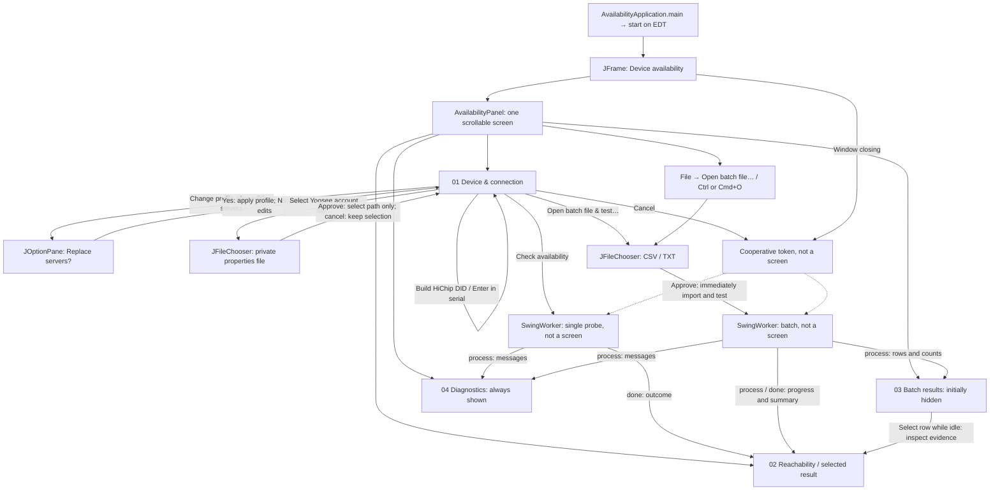

# UX rescue — analysis

**Analysis snapshot:** Phases 1–2, before implementation; no application or test source had changed. Reviewed 2026-10-08. Subsequent build/test results are recorded in [03-implementation.md](03-implementation.md); citations below describe the analyzed snapshot. Original line numbers can be checked with `git show 1691607^:<repository-relative-file>`.

## 1. Scope and evidence

Citation shorthand: **`M/` = `src/main/java/com/ivanocj/cameras/availability/`**; **`T/` = `src/test/java/com/ivanocj/cameras/availability/`**. All other paths are relative to the repository root. Line numbers refer to the source reviewed, not generated classes.

Repository-local inventory found **73 production Java files / 5,773 lines**, and **66 test/support Java files / 8,152 lines**, including **59 `*Test.java` files and 383 test-method declarations**. Counts include blank lines/comments; parameterized declarations are not executed-test counts. These are static scan results, not coverage or pass-rate claims.

Coverage: all Java sources were searched for entry points, Swing containers/dialogs, navigation, layout, keyboard bindings, SQL, and printing. The complete bootstrap and presentation code was read, together with the central routing, batch, probe, credentials, logging, and relevant test implementations. This is a **code-based UX audit, not an observed usability study**. No desktop window, real camera, production server, private credentials, or external configuration was accessed. Native-protocol research and every cryptographic implementation were not independently audited.

## 2. Application summary

### Purpose and likely users

This is **CamPulse**, a Java Swing diagnostic desktop for checking individual cameras or imported device lists. It sends network probes, reports evidence and endpoints, and distinguishes confirmed reachability from discovery and server-reported presence. Its executable entry point assembles those backends and opens one window. Sources: `pom.xml`; `M/bootstrap/AvailabilityApplication.java`; `M/application/service/ProtocolProbeRouter.java`.

**Inferred audience:** camera support/operations staff or technically knowledgeable device owners. Manual server lists, protocol selection, account files, DID construction, and packet-level diagnostics support that inference; job roles and actual user frequency cannot be established from code. Sources: `M/presentation/swing/AvailabilityPanel.java:330–388`; `M/presentation/AvailabilityPresenter.java:207–250`.

There are no database-backed CRUD, video-viewing, or print workflows exposed by the application UI. The complete form/menu contains check/import/credentials/DID/log actions, not create/edit/delete/print actions; backend routing performs probes. No JDBC/SQL, resource-bundle, or printing API usages were found in the Java-source search. Sources: `M/presentation/swing/AvailabilityPanel.java:237–388`; `M/application/service/ProtocolProbeRouter.java:23–30`.

### Business concepts and rules

| Concept | Meaning grounded in code |
|---|---|
| PPCS / XQ device DID | Composite `PREFIX-SERIAL-CODE`; normalized to uppercase. PPCS accepts a maximum 23-character DID; XQ adds a 20-byte identity constraint. `M/domain/model/DeviceId.java:5–18`; `M/domain/model/TransportProtocol.java:18–29`. |
| GWell identifier | Numeric identity whose **leading zero is meaningful**: it sets a namespace bit on the wire. Do not strip it. `M/domain/model/GwellDeviceId.java:5–25`. |
| IoTVideo identifier | Opaque, case-sensitive device key, not a converted PPCS DID. `M/domain/model/IotVideoDeviceId.java:5–12`. |
| Server profile | Known deployment/family route. The catalog contains **15 choices**, including Bell reference, HIP2P deployments, LAN-only choices, and account-backed Yoosee presence. `M/infrastructure/configuration/KnownServerProfiles.java:11–45`. |
| Server configuration | Comma-separated hosts, or encoded SY/XQ configurations. Encoded configurations choose their protocol; ordinary lists use the selected protocol. Default list-server ports differ: legacy 32100 versus Yoosee 51701. `M/infrastructure/configuration/ServerConfigurationParser.java:19–58`; `M/presentation/AvailabilityPresenter.java:46–60`. |
| Probe evidence | PPCS/XQ reachability requires a DID-matched session and an alive acknowledgment. A returned IP or server response alone is insufficient. `M/infrastructure/probe/UdpSessionProbe.java:276–286,350–363,381–400`. |
| LAN discovery / remote presence | GWell discovery is unauthenticated metadata. GWell/IoTVideo remote status is server-reported presence, **not tested P2P reachability**. `M/application/service/GwellAvailabilityService.java:52–81`; `M/infrastructure/probe/AbstractYooseeRemoteProbe.java:118–154`. |
| Batch entry/result | Source line, identifier, description, matched profile, import error, and eventual result. Invalid/unknown/ambiguous routes are retained and skipped rather than silently rerouted. `M/application/service/BatchAvailabilityService.java:397–450`. |
| Account credentials | User-supplied backend-specific properties, loaded per check; not a camera password. Selection is ephemeral; neither its path nor contents are in form memory. `M/infrastructure/configuration/FileYooseeCredentials.java:17–66`; `M/presentation/swing/AvailabilityPanel.java:241,519–524`; `M/presentation/swing/FormMemory.java:23–24`. |
| Remembered form | Last submitted identifier, profile, servers, protocol, timeout, and LAN option. Batch parallelism and account selection are not included. `M/presentation/swing/AvailabilityPanel.java:425–441,465–467`; `M/presentation/swing/FormMemory.java:23–24`. |

**Preservation boundary:** “reported online,” “discovered,” “server responded,” and “reachable” must remain different outcomes. Batch reachable counts deliberately include only confirmed direct/relay statuses. Sources: `M/presentation/AvailabilityPresenter.java:129–143,168–189,258–298`; `T/presentation/YooseePresenterTest.java:48–115`.

## 3. Build, setup, and test results

### Build configuration

- **Maven**, one root `pom.xml`; no Maven/Gradle wrapper or alternate build file was found by targeted build-file search. Java release **21** and UTF-8 are configured at `pom.xml:10–14`.
- Runtime dependencies: Jackson Databind **2.20.1**, SLF4J **2.0.20**, Logback Classic **1.6.5**, Commons CSV **1.14.1**, FlatLaf **3.6.1**. Test dependencies: ArchUnit **1.3.0**, Mockito **5.15.2**, JUnit Jupiter **5.11.4**. `pom.xml:13–59`.
- Dependency plugin **3.8.1** populates properties, compiler plugin **3.13.0** compiles, Surefire **3.5.2** uses a Mockito Java agent and headless Swing, and Shade **3.6.0** produces the executable JAR. Main class: `com.ivanocj.cameras.availability.bootstrap.AvailabilityApplication`. `pom.xml:63–117`.
- The only other located `main` is **test-only**: `LoggingProcessFixture.main`, a child-JVM logging/shutdown fixture using fake DNS/datagrams, not another desktop entry point. `T/integration/logging/LoggingProcessFixture.java:21–55`; caller `T/integration/logging/LoggingProcessTest.java:65–76`.
- Optional `installer` profile invokes `jpackage`; it was not run. FlatLaf native binaries are excluded from shading and its native loading is disabled in the theme. `pom.xml:99–106,121–178`; `M/presentation/swing/AvailabilityTheme.java:25–30`.

### Attempts made within the repository boundary

Observed tool versions: OpenJDK / `javac` **21.0.12.1**, Maven **3.10.0**. Normal tool execution was used; no external configuration/cache directories were inspected.

To avoid reading home-directory Maven settings/cache or downloading external artifacts, both attempts used empty explicit settings at `target/ux-rescue-build/settings.xml`, offline mode, and a repository-contained artifact cache:

```sh
MAVEN_OPTS="-Duser.home=$PWD -Djava.io.tmpdir=$PWD/target/ux-rescue-build" \
  mvn --offline --batch-mode --no-transfer-progress \
  --settings target/ux-rescue-build/settings.xml \
  --global-settings target/ux-rescue-build/settings.xml \
  -Dmaven.repo.local="$PWD/target/ux-rescue-build/repository" compile
```

The same command was run with `test` instead of `compile`.

| Attempt | Result |
|---|---|
| `compile` | Exit **1**, plugin-resolution failure: `maven-dependency-plugin:3.8.1` is unavailable in the repository-contained offline cache. **Java compilation never started.** |
| `test` | Exit **1**, same resolution failure. **No tests executed.** |
| Desktop/manual checks | Not run. Production startup uses platform Preferences and defaults disk logging to a user-home directory; launching it would not be a repository-confined validation. `M/bootstrap/AvailabilityApplication.java:43–63`; `M/infrastructure/logging/ApplicationLogging.java:53–65`. |

These failures do **not** establish that the source fails to compile or that tests fail. Existing `target/classes/` was not treated as a fresh-build result. The only non-report file created was the ignored, build-only settings file; `/target/` is already ignored (`.gitignore:1`).

**Additional test-boundary issue:** `PreferencesFormMemoryTest` uses actual platform user Preferences, and bootstrap tests initialize them too. A default full-suite run is not automatically repository-confined even with a local Maven cache. `T/presentation/swing/PreferencesFormMemoryTest.java:20–34`; `T/bootstrap/AvailabilityApplicationTest.java:27–35`; `M/bootstrap/AvailabilityApplication.java:61–63`. See roadmap gate R0.

## 4. Complete Swing screen and navigation inventory

### Container/dialog usages

| Type | All located application usages |
|---|---|
| `JFrame` | One constructed desktop window. Import, construction, parameter, and close constant: `M/bootstrap/AvailabilityApplication.java:30,46,68,75`. It holds a menu and a scroll-wrapped `AvailabilityPanel`: lines 69–85. |
| `JPanel` | One screen class, `AvailabilityPanel extends JPanel` (import 61; declaration 79). `batchCard` field uses the card helper at 121–122. Explicit panel constructors: equal-width cards 363; body 371; diagnostics header 379; diagnostics body 383; paired-control return type/constructor 706–707; `Column` field/constructor 724. The helper builds the hero/cards/field subpanels at 320–388,693–760. All are regions of the same window, not separate screens. `M/presentation/swing/AvailabilityPanel.java`. |
| `JOptionPane` | One edited-server replacement confirmation: import 60, call 420, option constant 422. Caller is profile selection at 391–405. `M/presentation/swing/AvailabilityPanel.java:391–422`. |
| `JDialog` / `JInternalFrame` | No direct usages found in repository Java sources. File choosers create modal dialogs internally; those are included below. |
| Other modal UI | Two `JFileChooser` open dialogs: batch file at 511–517 and authorized account file at 519–525. `M/presentation/swing/AvailabilityPanel.java`. |
| Test-only `JFrame` usages | Import 20, mocks 41/58, close constant assertion 49; no additional application screen. `T/bootstrap/AvailabilityApplicationTest.java:20–63`. |

### Navigation map

The diagram distinguishes UI regions/dialogs from explicitly labeled workers and cancellation, which are **not screens**.



Map evidence: startup/window `M/bootstrap/AvailabilityApplication.java:49–85`; actions and selection `M/presentation/swing/AvailabilityPanel.java:100–106,183–196,292–318,391–422`; single worker 452–509; choosers/batch worker 511–622.

There is **no deep screen hierarchy or nested modal-dialog chain to consolidate**. A profile change can show one confirmation; each file action opens one chooser. Errors render in the result card, not an error-dialog chain. Sources: `M/presentation/swing/AvailabilityPanel.java:419–422,460–463,511–525,624–630`.

## 5. Main workflow walkthroughs

Frequency rankings are **inferences from prominence**, not telemetry. “Activation” means a button/menu command, logical option selection, or chooser approval; typing, file browsing, and scrolling are excluded. Physical click counts depend on platform widgets and window size.

| Likely rank | Workflow and user path | Activations and evidence |
|---|---|---|
| **1 — central** | **Check one camera.** Select the appropriate known profile if the current one is unsuitable → enter protocol-specific identifier → optionally edit servers/timeout/LAN/transport → Check availability → read outcome, addresses, and evidence. Inputs lock until completion. | **1** with suitable current settings; **2** including profile choice; an edited-list confirmation adds **1**. Primary/default button: `M/presentation/swing/AvailabilityPanel.java:183–189,330–340,452–509,678–690`. |
| **2 — central** | **Check a file of cameras.** Set shared timeout/LAN and concurrency → Open batch file & test… (or File menu / shortcut) → select/approve CSV or TXT → watch rows/counts → after completion, sort/select a row to inspect it. Opening starts work immediately; there is no preview screen. | Button → chooser approval: **2**; menu path: **3**; row inspection adds **1**. The only menu command/accelerator is batch opening. `M/presentation/swing/AvailabilityPanel.java:100–106,245–269,306–310,527–622`. |
| **3 — specialized subset of rank 1** | **Yoosee remote presence.** Choose GWell or IoTVideo remote profile → select an authorized account properties file → enter numeric GWell ID or original IoTVideo key → Check → interpret server-reported presence, not P2P reachability. GWell with LAN enabled also scans first. | Profile + account button + chooser approval + Check: **4**, plus any option edits/confirmation. `M/presentation/swing/AvailabilityPanel.java:292–300,519–525`; `M/infrastructure/configuration/KnownServerProfiles.java:43–45`; `M/application/service/GwellAvailabilityService.java:37–45,66–81`. |
| **4 — specialized subset of rank 1** | **LAN-only check.** Choose PPCS/XQ LAN-only or GWell LAN discovery profile → leave servers blank and ensure LAN search is selected → enter identifier → Check. PPCS/XQ still seek an alive-confirmed session; GWell reports discovery only. | Normally profile + Check: **2**. `M/infrastructure/configuration/KnownServerProfiles.java:41–43`; `M/presentation/AvailabilityPresenter.java:52–60`; `M/infrastructure/probe/UdpSessionProbe.java:159–160,356–363`; `M/application/service/GwellAvailabilityService.java:52–67`. |
| **5 — secondary tool** | **Construct a HiChip DID.** Enter prefix and unsigned numeric serial → Build HiChip DID (or Enter in serial) → generated DID replaces the main identifier → independently choose the correct deployment/protocol → Check. Generation does not choose a route or start a probe. | Build + optional profile + Check: **2–3**, plus confirmation if needed. `M/presentation/swing/AvailabilityPanel.java:123–125,312–313,343–345,444–450`; `M/presentation/AvailabilityPresenter.java:64–71`. |
| **6 — troubleshooting** | **Inspect/copy diagnostics or result evidence.** Read selectable text and table tooltips; select a completed batch row; Clear empties the on-screen log. No export/print action is exposed. | Row inspection **1**; Clear **1**. `M/presentation/swing/AvailabilityPanel.java:112–118,275–287,306–314,378–388,663–671`. |

### Workflow details that are easy to misunderstand

- **First-run settings:** first catalog profile (Bell reference), 10-second timeout (1–120), LAN search on, batch concurrency 8 (1–16), HiChip prefix `FFFF`. Previously submitted form values can replace most connection defaults. Sources: `M/presentation/swing/AvailabilityPanel.java:95–98,123,174–177,425–441`; `M/infrastructure/configuration/KnownServerProfiles.java:12–16`; `M/application/service/BatchAvailabilityService.java:48–49`.
- **Single and batch routing differ intentionally in current code.** Single checks use the visible configuration; there is no DID-prefix auto-selection in `startCheck`. Batch checks ignore the single form's profile/server list/protocol and route each identifier through the catalog. Single and batch share timeout/LAN settings and the injected runner/account source; concurrency applies only to batch. Sources: `M/presentation/swing/AvailabilityPanel.java:458–467,529–560`; `M/application/service/BatchAvailabilityService.java:397–440`; preservation test `T/presentation/swing/BatchAvailabilityPanelTest.java:49–104`.
- **Batch file contract:** UTF-8, `.csv` extension selects CSV parsing, exactly `Serial` and `Description` headers (case-insensitive, reorderable), quoted descriptions supported; TXT has one identifier per nonblank/non-comment line. Numeric non-composite IDs require explicit `GWELL:` / `IOTVIDEO:` tags. Sources: `M/presentation/swing/AvailabilityPanel.java:529,553–554`; `M/application/service/BatchAvailabilityService.java:58–139`; `M/domain/model/DeviceIdentifier.java:17–29`; `T/application/service/BatchCsvImportTest.java:40–100`.
- **Batch identity/order:** separate source lines remain separate rows; equivalent PPCS identities and GWell aliases are serialized, while XQ zero-padded ASCII IDs remain distinct. Updates arrive in completion order, final results retain source order. Sources: `M/application/service/BatchAvailabilityService.java:200–205,263–375,388–389`; `M/domain/model/TransportProtocol.java:32–39`; `M/presentation/swing/BatchResultsTableModel.java:22–40`.
- **Cancel is cooperative:** it sets a token; it does not interrupt the worker or immediately unlock controls. Batch waits for active cleanup. Sources: `M/presentation/swing/AvailabilityPanel.java:302–305,472–480,504–505,617–618`; `M/application/service/BatchAvailabilityService.java:332–346`; `T/presentation/swing/ParallelBatchAvailabilityPanelTest.java:141–204`.

## 6. Measured complexity hotspots

Measurements are static source counts, not rendered-widget measurements.

| Measurement | Finding and source |
|---|---|
| Largest UI class | `AvailabilityPanel`: **761 lines**, also the largest production source. `M/presentation/swing/AvailabilityPanel.java:1–761`. Presenter: **307**, window/bootstrap: **87**, table model: **86**, Preferences adapter: **60**, theme: **43**, memory interface: **26** lines. |
| Form density | **9 editable controls** (3 text fields, server text area, 2 combos, 2 spinners, checkbox), **7 buttons**, 3 read-only text areas, and **31 named member components/containers**. The helper adds **14 field labels**. Not a count of Swing-internal widgets. `M/presentation/swing/AvailabilityPanel.java:89–141,203–235,330–360`. |
| Longest UI orchestration methods | `startBatch`: **96 lines** (527–622); `startCheck`: **58** (452–509); `configureComponents`: **54** (237–290). `bindActions` is **27** lines (292–318); the longest inline listener body is the **6-line** batch selection listener (306–311). The problem is delegated worker/state coordination, not giant inline listeners. |
| Longest worker UI callback | Batch `process`: **25 lines** (569–593); batch `done`: **17** (604–620). `M/presentation/swing/AvailabilityPanel.java`. |
| Batch table | **12 columns**, preferred widths total **2,205 pixels**, fixed five-row preferred viewport, horizontal scrolling, sorting already enabled, no configured filter. `M/presentation/swing/AvailabilityPanel.java:257–269`; `M/presentation/swing/BatchResultsTableModel.java:15–17,59–82`. |
| Navigation depth | One application window/screen. Deepest ordinary command path is File → Open batch file → chooser approval (**3 activations**); row inspection makes **4**. No nested screen stack. `M/presentation/swing/AvailabilityPanel.java:251–256,306–310,511–516`. |
| Layout/sizing | **No `null` layout or `setBounds` usage found.** Already uses BorderLayout/GridBagLayout/GridLayout. Remaining constraints: equal two-column form, fixed font sizes, table widths, and minimum window **720×560**. `pack()` is not capped to available screen bounds. `M/presentation/swing/AvailabilityPanel.java:159–166,260–288,320–367,693–744`; `M/bootstrap/AvailabilityApplication.java:38,71–84`. Actual clipping/HiDPI behavior remains unverified. |
| Keyboard support | Enter/default Check, Enter in HiChip serial, File mnemonic, and platform Ctrl/Cmd+O already exist. No application bindings for cancel, field/button mnemonics, explicit initial focus, or tested focus traversal were found. Labels do use `setLabelFor`. `M/presentation/swing/AvailabilityPanel.java:183–189,248–256,292–318,714–718`. |

## 7. UX audit

Impact: H = threatens correct task completion; M = material friction; L = secondary polish. Effort: S/M/L = relative implementation + verification effort, not time estimates. Impacts are code-informed hypotheses to validate with users.

| Location (class / screen) | Problem | User impact (H/M/L) | Fix effort (S/M/L) |
|---|---|---|---|
| **UX01** — `AvailabilityPanel` connection card (`M/presentation/swing/AvailabilityPanel.java:330–345`) | Single-check setup, batch-only concurrency, account controls, and DID construction compete in one always-visible form. No progressive disclosure. | H | M |
| **UX02** — Single versus batch setup (`M/presentation/swing/AvailabilityPanel.java:458–467,529–560`; `M/application/service/BatchAvailabilityService.java:397–440`) | Visible server/profile controls appear to configure batch work but are not used for its routing. Users can expect a different deployment than the one tested. | H | S |
| **UX03** — Heading/labels/help (`M/presentation/swing/AvailabilityPanel.java:120,240–246,325,332–339`; `M/presentation/AvailabilityPresenter.java:91–100`) | Engineering vocabulary (“Known lists,” “Transport,” DID/identifier/code/serial); subtitle omits implemented remote presence; batch-format hint is inside a card hidden before import. | M | S |
| **UX04** — Validation (`M/presentation/swing/AvailabilityPanel.java:444–463,649–660`) | Input errors are in the other card, not beside the offending field; no explicit focus/field-error marker. User must infer what to repair. Existing messages and clearing stale metrics are positives. | M | M |
| **UX05** — Keyboard access (`M/presentation/swing/AvailabilityPanel.java:183–189,248–256,292–318,714–718`) | Existing Enter/open shortcuts and label associations do not provide button/field mnemonics or a cancel shortcut. Many irrelevant controls remain in the ordinary tab path. | M | S |
| **UX06** — Window/cards (`M/bootstrap/AvailabilityApplication.java:71–84`; `M/presentation/swing/AvailabilityPanel.java:363–367,378–388`) | Whole-window scrolling plus permanently side-by-side cards and diagnostics can separate actions from results on small/scaled displays. No available-screen cap. This is a layout risk, not observed clipping. | H | M |
| **UX07** — Batch table (`M/presentation/swing/AvailabilityPanel.java:257–269`; `M/presentation/swing/BatchResultsTableModel.java:15–17`) | 12 columns / 2,205 preferred pixels and five-row viewport; no identifier/description/outcome filtering. Large lists require scanning and scrolling. Sorting is already present. | M | M |
| **UX08** — Elapsed sorting (`M/presentation/swing/BatchResultsTableModel.java:59–60,81–82`; `M/presentation/swing/AvailabilityPanel.java:257`) | Elapsed values are Strings such as `"100 ms"`; no numeric comparator is supplied, so default sorting is textual rather than duration order. | M | S |
| **UX09** — Shared result card (`M/presentation/swing/AvailabilityPanel.java:306–310,649–660`; `T/presentation/swing/P2pAvailabilityPanelTest.java:124–143`) | Selecting a batch row replaces the main result while the identifier form intentionally stays unchanged. Row identity is only in detailed evidence, not a prominent result caption. | M | S |
| **UX10** — Cancellation (`M/presentation/swing/AvailabilityPanel.java:302–305,678–690`) | Cancel gives no immediate “cancelling / waiting for cleanup” acknowledgment; checking status and enabled Cancel can persist. | M | S |
| **UX11** — Account selection (`M/bootstrap/AvailabilityApplication.java:56–63`; `M/presentation/swing/AvailabilityPanel.java:89–90,293–300`; `M/infrastructure/configuration/FileYooseeCredentials.java:26–63`) | “Selected” means a path, not validated credentials. An environment-configured file is not reflected by initial button wording. Format/provisioning help is absent from this screen. | M | M |
| **UX12** — Failure wording (`M/presentation/AvailabilityPresenter.java:150–152`; `M/infrastructure/probe/AbstractYooseeRemoteProbe.java:144–146`) | Legacy errors can expose raw exception/class wording; remote failures deliberately combine several causes for safety. Neither supplies a consistent, safe recovery path in the UI. Do not remove redaction. | M | M |
| **UX13** — Diagnostics (`M/presentation/swing/AvailabilityPanel.java:270–288,663–671`) | Small fixed 12-point technical text and unconditional caret-to-end movement make sustained log inspection harder while messages arrive. HiDPI/readability needs real-display verification. | L | S |

**Not found:** duplicate application screens, absolute positioning, business SQL in listeners, or modal error chains. Do not spend rescue effort “fixing” absent problems. Container inventory and complete action/layout methods above support these negative findings.

## 8. Technical risks and existing strengths

1. **Preserve existing separation and threading.** The toolkit-independent presenter handles input/result wording, application services handle routing/import/checking, and both probe/file reading paths already use `SwingWorker`. `process`/`done` update Swing; tests explicitly assert EDT behavior. This is not a rewrite candidate. `M/presentation/AvailabilityPresenter.java:21–60`; `M/presentation/swing/AvailabilityPanel.java:474–508,543–621`; `T/presentation/swing/AvailabilityPanelTest.java:44–82`; `T/presentation/swing/BatchAvailabilityPanelTest.java:107–148`.
2. **Preferences I/O is still on the EDT.** Startup loads form memory inside `invokeLater`; Check saves and calls `Preferences.flush()` before starting its worker or showing busy feedback. This is a potential latency hotspot, not a measured freeze. `M/bootstrap/AvailabilityApplication.java:49–65`; `M/presentation/swing/AvailabilityPanel.java:177,465–474`; `M/presentation/swing/PreferencesFormMemory.java:45–57`.
3. **Dense UI orchestration has regression risk.** `AvailabilityPanel` owns file selection, worker lifecycle, cancellation, batch progress, selection, and persistence sequencing. Extract only small responsibilities under characterization tests; networking/domain rules are already outside the view. `M/presentation/swing/AvailabilityPanel.java:292–318,452–647`.
4. **Background work can still flood the EDT.** Each published diagnostic appends/trims/scrolls text; each completed row fires an update and recalculates progress. The 2,000-line cap bounds retained log text, not published-event backlog or imported rows. Measure representative large batches before coalescing delivery. `M/presentation/swing/AvailabilityPanel.java:569–600,663–671`; `M/presentation/swing/BatchResultsTableModel.java:22–35`; `M/application/service/BatchAvailabilityService.java:63–82,90–134`.
5. **Global settings, not a static domain singleton.** Theme setup mutates system/UIManager settings; logging resets shared LoggerContext and installs a default uncaught-exception handler. Test isolation matters. Probe session state is per check, and router/credentials are instance-owned. `M/presentation/swing/AvailabilityTheme.java:25–30`; `M/infrastructure/logging/ApplicationLogging.java:80–85,216–230`; `M/infrastructure/probe/UdpSessionProbe.java:60–105`; `M/infrastructure/configuration/FileYooseeCredentials.java:20–27`.
6. **Some failures are only operationally logged.** Preferences failure falls back without user-visible feedback; the default uncaught handler logs exceptions, and retained INFO/WARN/ERROR logging can exert queue backpressure. These are potential UI failure/latency paths, not established field incidents. `M/presentation/swing/PreferencesFormMemory.java:20–25,55–57`; `M/infrastructure/logging/ApplicationLogging.java:130–134,216–220`; `M/infrastructure/logging/OperationalAsyncAppender.java:14–16`.
7. **Batch concurrency is not effective parallelism for every backend.** GWell LAN listener and each Yoosee remote backend use ownership locks; remote queue time consumes the timeout. Raising concurrency or eliminating locks could change behavior. `M/infrastructure/probe/GwellLanDiscovery.java:27–36,45–71`; `M/infrastructure/probe/AbstractYooseeRemoteProbe.java:44–45,74–86,161–169`.
8. **No blanket “missing tests” claim is justified.** Existing tests cover worker/EDT behavior, cancellation/cleanup, CSV formats, route ambiguity, endpoint semantics, account secrecy, and architectural boundaries. Gaps for this rescue are actual focus traversal/keyboard activation, small-window/HiDPI behavior, prominent result context, and upcoming table filters/comparators. Headless Surefire and mocked frames do not validate real geometry/accessibility. `pom.xml:82–86`; `T/bootstrap/AvailabilityApplicationTest.java:39–63`; `T/presentation/swing/AvailabilityPanelTest.java:254–263,609–617`; `T/application/service/BatchAvailabilityServiceTest.java:49–84,139–186`; `T/architecture/LayeredArchitectureTest.java:15–42`.
9. **Compatibility-sensitive logic must stay untouched.** Custom HiChip digest uses zero initial MD5 state words; it is not standard MD5. Identifier normalization, timeout budgets, alive confirmation, and skipped routes are likewise contracts, not syntax-cleanup opportunities. `M/domain/service/HichipUid.java:29–71`; `M/domain/model/TransportProtocol.java:32–39`; `M/application/service/AvailabilityCheckService.java:77–113`; `M/infrastructure/probe/UdpSessionProbe.java:356–391`.

No deprecated Swing APIs were identified in the fully read UI files. A compiler/deprecation audit remains blocked by dependency resolution; this is not a claim about every library or native research artifact.

## 9. Assumptions and open questions

- **Assumption:** this source snapshot represents the interface users receive. It already includes FlatLaf, resizable layouts, form memory, background workers, and tests; whether those improvements have reached the troubled deployment is unknown. `M/presentation/swing/AvailabilityTheme.java:25–30`; `M/bootstrap/AvailabilityApplication.java:71–84`; `M/presentation/swing/AvailabilityPanel.java:174–180,474–508`.
- **Assumption:** one-camera and file-based checks deserve priority because they have direct buttons, and batch also has the sole menu command/accelerator. Validate with actual users before larger restructuring. `M/presentation/swing/AvailabilityPanel.java:99–110,248–256,330–345`.
- Who are the real users, their language, usual device family, and level of protocol knowledge? How often do they run single checks, mixed-family batches, and HiChip generation?
- What OS, minimum display size, scaling, keyboard/accessibility needs, and typical/max batch size must be supported? The code sets only a minimum window and preferred table sizes (`M/bootstrap/AvailabilityApplication.java:38,83`; `M/presentation/swing/AvailabilityPanel.java:260–264`).
- Can the required Maven artifacts be supplied **inside the repository** for a confined build? Until then, compile/test status is unknown. No external cache/config inspection is proposed.
- Is Bell reference an intended general default, or should deployment selection be mandatory/suggested? Current single/batch routes differ. **Do not change that policy without business approval.** `M/infrastructure/configuration/KnownServerProfiles.java:12–16,32–34`; `M/presentation/AvailabilityPresenter.java:52–60`; `M/application/service/BatchAvailabilityService.java:404–425`.
- Who provisions the authorized Yoosee account properties/session tokens, how are expiry/rotation communicated, and may UI guidance show field names? The loader consumes fields but does not obtain credentials (`M/infrastructure/configuration/FileYooseeCredentials.java:44–63`). No private file was opened.
- Do users need export/print/history, or simply to inspect current results? These functions are not present in the action inventory (`M/presentation/swing/AvailabilityPanel.java:237–318`); adding them would be new scope.
- May display-only error guidance distinguish causes without weakening remote redaction? Current remote code intentionally suppresses nested details (`M/infrastructure/probe/AbstractYooseeRemoteProbe.java:144–146`).
- Is deferred/asynchronous settings persistence acceptable, including shutdown ordering? Moving the current synchronous save changes timing and requires an explicit decision (`M/presentation/swing/AvailabilityPanel.java:465–474`; `M/presentation/swing/PreferencesFormMemory.java:45–57`).

**Conclusion:** the evidence supports a focused Swing rescue: clarify routing/evidence, improve task context and keyboard access, then reduce visible form density and improve batch inspection. It does not support a UI-framework migration or a broad architectural rewrite.
